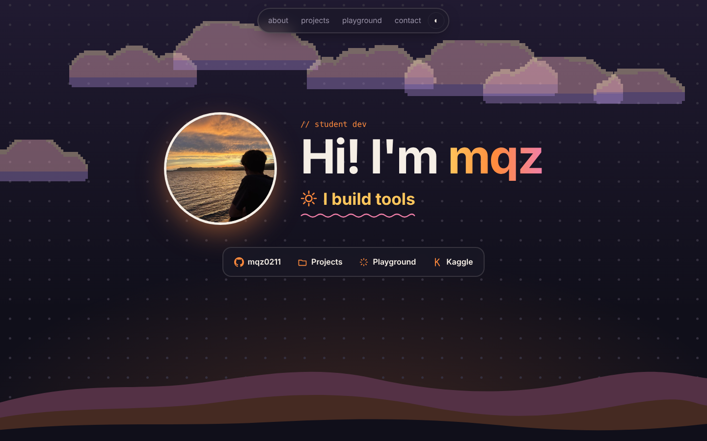
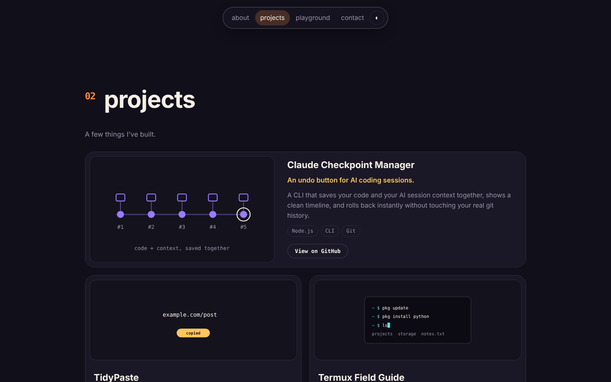
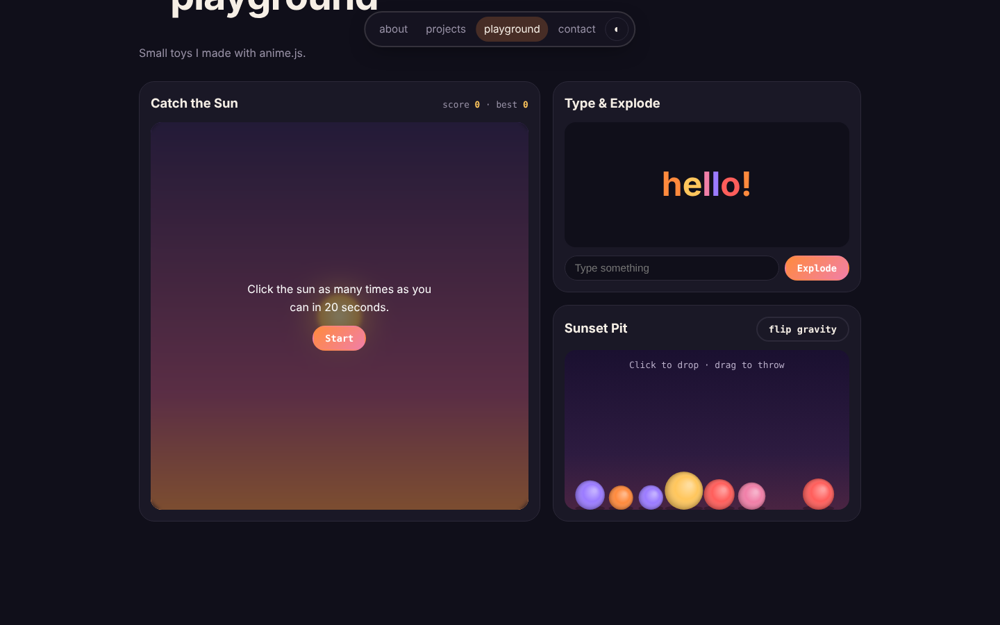
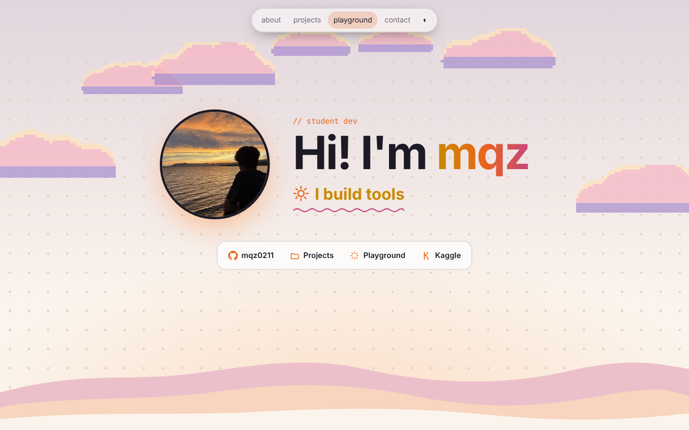
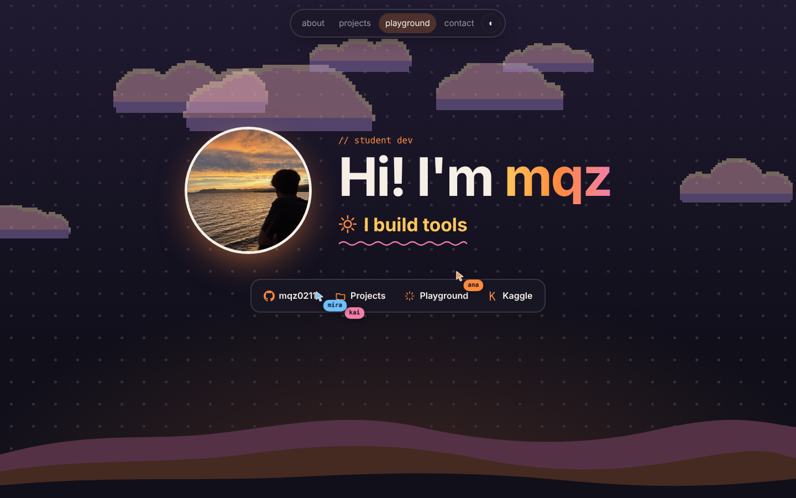
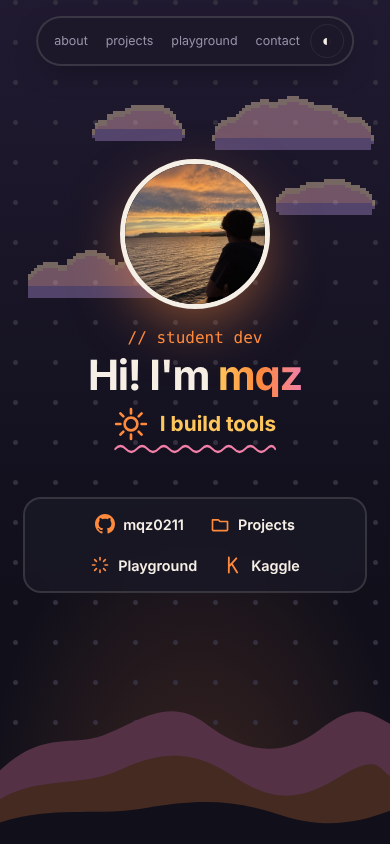

# mqz — portfolio

My personal portfolio, built from scratch for Hack Club [Swirl](https://swirl.hackclub.com/): a sunset-themed one-page site with a hero, project cards, and a playground of small interactive toys.

**Live site:** https://portfolioo-tan-seven.vercel.app



## Preview

| Projects | Playground |
| --- | --- |
|  |  |

| Light mode | Swarm rebuild | Mobile |
| --- | --- | --- |
|  |  |  |

> The screenshots are captured locally, so some entrance animations are shown in their finished state.

## Tech stack

| Area | What I used |
| --- | --- |
| Markup and styling | HTML5, CSS3 (custom properties, `backdrop-filter`, `@property`, grid/flex) |
| Scripting | Vanilla JavaScript (no framework, no build step), Canvas 2D |
| Animation | [anime.js](https://animejs.com/) 3.2.2 for most motion, [GSAP](https://gsap.com/) 3.15 + ScrollTrigger for scroll-linked effects and the project scenes |
| Data | GitHub REST API (live star counts and stat counters, with static fallbacks) |
| Fonts | Space Grotesk and JetBrains Mono (Google Fonts) |
| Hosting | Vercel (static site) |

anime.js, GSAP and the fonts load from CDNs, so the site needs an internet connection to look right.

## Features
1. **Animated hero**: the greeting animates in letter by letter, the photo spins in, and the tagline scrambles between words over a self-drawing squiggle
2. **Pixel-art sunset clouds**: generated with code on tiny canvases every visit, drifting slowly
3. **Interactive dot grid**: click the sky to send a ripple out from that point (`anime.stagger` with `grid` + `from`)
4. **Layered hills** with scroll parallax
5. **Featured projects**: hand-picked cards with live star counts from the GitHub API, each with a small looping SVG scene (`project-scenes.js`, GSAP) showing what the project does
6. **Playground**
   - *Catch the sun*: a 20-second click game with a saved best score
   - *Type & explode*: letters bounce in as you type and blow apart on "boom"
   - *Sunset Pit*: drop bouncing balls, grab and throw them around, and flip gravity (small canvas physics engine)
7. **Animated stat counters** pulled from the GitHub API
8. **Scroll reveal** and a floating nav that highlights the current section
9. **Dark / light mode**, saved in localStorage
10. **Custom cursor** and photo tilt on hover
11. **Hidden easter egg** (Konami code)
12. Responsive layout and `prefers-reduced-motion` support
13. **GSAP + ScrollTrigger**: scroll progress bar, nav drop-in, hero fade-out on scroll, staggered stat cards and skill pills, magnetic contact buttons
14. **Liquid Glass look on Apple devices** (iPhone, iPad, Mac): frosted glass nav, link bar and buttons with rim light, a highlight that follows the pointer, and press-to-lift lenses. Add `?glass=on` to the URL to see it on other devices
15. **Swarm rebuild** (`swarm.js`): wipes the page, then a swarm of named multiplayer-style cursors rebuilds it live, dragging out boxes with size badges and typing text with a caret. Start it from the footer button or press Alt+Shift+S; Esc or a click exits. Scroll to keep it building, and more cursors join when you scroll fast. Inspired by the Swarm Rebuild Chrome extension

## How to run it
There is nothing to install or build. It is plain static files.

1. Clone the repo
   ```
   git clone https://github.com/mqz0211/portfolioo.git
   cd portfolioo
   ```
2. Serve the folder with any static server, for example
   ```
   python3 -m http.server 8000
   ```
   or `npx serve`
3. Open http://localhost:8000

You can also just double-click `index.html`, but a local server is closer to how it runs on Vercel.

Useful URL options: `?glass=on` / `?glass=off` forces the Liquid Glass look on or off, and `?swarm` starts the swarm rebuild after the page loads.

If the GitHub API rate limit is hit, the project cards and stat counters fall back to their built-in values.

## Project structure
```
index.html          page markup
style.css           all styles (themes, Liquid Glass, swarm overlay)
main.js             hero, clouds, projects, stats, playground toys
project-scenes.js   animated SVG scenes for the project cards
gsap-effects.js     GSAP + ScrollTrigger layer
liquid-glass.js     pointer highlight for the Apple glass look
swarm.js            swarm rebuild effect
assets/             photos and favicon files
docs/screenshots/   images used in this README
```

## Deploy
Hosted on Vercel as a static site. Pushing to `main` redeploys it, with no build command or output directory to set.
